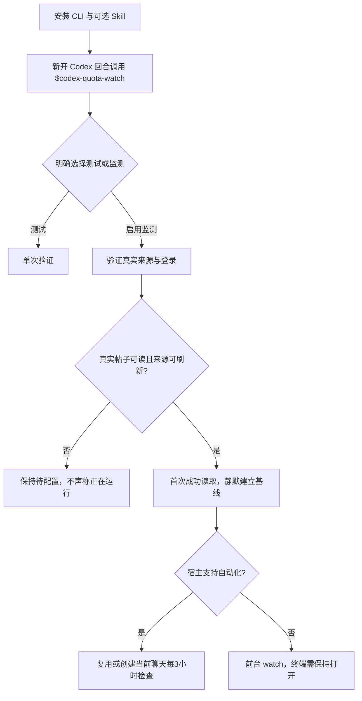

# Codex Quota Watch

中文名：**Codex 额度重置检测**。

[](pyproject.toml)
[](LICENSE)
[](docs/INSTALL.md)

完整安装与数据源配置见 [安装指南](docs/INSTALL.md)；项目说明页见 [docs/index.html](docs/index.html)。

**English overview:** A small, local Python 3.10+ watcher that reads JSON posts from an explicitly configured source, filters an author allowlist, and keeps reset announcements pending until you acknowledge them. Windows popups are optional; no network source or account credentials are installed by this package.

这是一个本地运行的 Codex 配额重置动态提醒器。它读取用户提供的 JSON 快照，或通过参数数组启动用户配置的数据源；只处理 allowlist 中作者的帖子。程序先静默建立基线，之后把“重置公告”和“明确报告已经完成”视为两个阶段，各自最多提醒一次。提醒会一直保持待确认，直到你点击窗口中的确认按钮或执行 `ack` 命令；关闭窗口或测试自动关闭不会确认提醒。

## 下载：程序包和 Skill 是两回事

| 下载 | 内容与用途 |
|---|---|
| [⬇ 下载 source ZIP](https://github.com/JIAQIRUOMEN/codex-quota-watch/releases/latest/download/codex-quota-watch-source.zip) · [查看所有 Releases](https://github.com/JIAQIRUOMEN/codex-quota-watch/releases) | Python CLI、Windows 提醒器、示例与文档。需要实际运行 CLI 时安装它。 |
| [⬇ 下载 Skill ZIP](https://github.com/JIAQIRUOMEN/codex-quota-watch/releases/latest/download/codex-quota-watch-skill.zip) · [查看所有 Releases](https://github.com/JIAQIRUOMEN/codex-quota-watch/releases) | 只有给 Codex 使用的 `SKILL.md` 指令，不含 Python CLI，也不会自行运行或建立定时任务。 |

以上链接指向最新 GitHub Release 资产；若项目尚未发布 Release，资产链接暂不可用。完整新手教程见[安装指南](docs/INSTALL.md)。

### 安装 Python CLI

需要 Python 3.10+。下载并解压 source ZIP，进入其中包含 `pyproject.toml` 的 `codex-quota-watch` 目录，再运行：

```powershell
python -m pip install .
codex-quota-watch --help
```

也可以直接从 GitHub 安装：

```powershell
python -m pip install "git+https://github.com/JIAQIRUOMEN/codex-quota-watch.git"
```

CLI 安装不会启动监测。`python -m codex_quota_watch` 也可用于调用命令行。

### 安装 Codex Skill（可选）

在 Windows 上，默认安装目录为 `$HOME\.codex\skills\codex-quota-watch`（`$HOME` 通常是 `C:\Users\你的用户名`）。如果设置了自定义 `$env:CODEX_HOME`，则使用 `$env:CODEX_HOME\skills\codex-quota-watch`。

Skill ZIP 内只有一层目录：`codex-quota-watch\SKILL.md`。把它解压到 skills 根目录即可，不要再额外套一层同名文件夹：

```powershell
$skillRoot = if ($env:CODEX_HOME) { Join-Path $env:CODEX_HOME 'skills' } else { Join-Path $HOME '.codex\skills' }
New-Item -ItemType Directory -Force -Path $skillRoot | Out-Null
Expand-Archive -LiteralPath .\codex-quota-watch-skill.zip -DestinationPath $skillRoot -Force
Get-Content (Join-Path $skillRoot 'codex-quota-watch\SKILL.md') -TotalCount 8
```

安装后开一个新的 Codex 回合并调用 `$codex-quota-watch`。如果 Codex 还识别不到该 Skill，重启 Codex 后再试。Skill ZIP 不含 Python 程序包；要运行监测 CLI，仍需单独安装 source ZIP 或用 pip 安装上面的 Python 包。

## 首次启用监测

安装不会自动读取帖子、打开窗口或安排轮询。需要监测时，在 Codex 明确说 **“启用额度监测”** 或 **“每3小时监测”**；只想检查安装则说只做一次测试。首次启用需要可用的 Python CLI，以及能登录并读取目标账号真实帖子的可刷新数据源。此项目不提供 X 登录或内置抓取器。



成功验证真实来源后，首次读取只建立静默基线。宿主支持自动化时，Codex 会先检查并复用已有匹配任务，再为当前聊天安排每3小时检查；如果读不到真实内容，设置会保持待完成，不会使用样例伪装成正在监测。电脑休眠、离线或应用关闭可能延迟检查；不提供全天候云端监控，也不会安装后台服务或开机自启。

## 离线示例

以下 fixtures 都是**合成示例**，不是 Tibo 的真实帖子，也不代表当前配额公告。示例帮助验证状态转换，不需要网络或账号登录。

```powershell
# 创建本地数据库和收据目录
codex-quota-watch --state-dir .\state init

# 第一次读取只建立静默基线
codex-quota-watch --state-dir .\state poll --input .\examples\baseline.json --dry-run

# 后续快照产生一条公告提醒
codex-quota-watch --state-dir .\state poll --input .\examples\announcement.json --dry-run

# 再次读取相同公告不会重复建立提醒
codex-quota-watch --state-dir .\state poll --input .\examples\announcement.json --dry-run

# 同一帖子 ID 明确报告完成时，生成第二阶段提醒
codex-quota-watch --state-dir .\state poll --input .\examples\confirmed.json --dry-run

# 查看待确认提醒及完整记录
codex-quota-watch --state-dir .\state status

# 将 <ID> 替换为 status 输出的提醒 ID；这是唯一的确认操作
codex-quota-watch --state-dir .\state ack <ID>
```

`--dry-run` 会生成校验后的事件 JSON，但不会打开窗口。真实提醒可在 Windows 上省略它。点击 Windows 窗口的“已知晓”按钮或显式执行 `ack <ID>` 会确认；窗口关闭、测试自动关闭和显示收据都不会确认。Windows 通知由包内固定的 PowerShell/WPF 脚本呈现，帖子内容作为 JSON 数据读取，不会拼进命令行脚本。

## 配置帖子来源

可以把 JSON 文件作为快照输入。支持帖子数组，以及常见的 `{ "data": [...] }`、`{ "posts": [...] }` 包装格式。字段接受 `id`/`rest_id`、`author`/`user.username`、`text`/`full_text` 和可选的 `created_at`、`url`。

也可提供一个 JSON 编码的 argv 数组；程序用 `subprocess` 直接启动它，不经过 shell：

```powershell
codex-quota-watch --state-dir .\state poll --source-command-json '["opencli","twitter","tweets","thsottiaux","--limit","20","-f","json"]' --source-timeout 30 --dry-run
```

此命令要求已配置 OpenCLI 及其数据源。Windows 若 `opencli` 入口是 `.cmd` shim，请将 argv 第一项改成该 shim 的实际路径；`subprocess` 使用 `shell=False` 启动固定 argv，不把帖子内容拼入命令。请确认 OpenCLI 版本支持 `twitter tweets <username> --limit <n> -f json` 并输出受支持的 JSON 格式。项目不安装 X/Twitter 登录、OpenCLI、凭证或私有数据源。源数据会作为不可信数据验证；命令超时、非零退出或无效 JSON 会报告错误，且不会更新为成功轮询。

循环检查示例（默认每三小时一次）：

```powershell
codex-quota-watch --state-dir .\state watch --input .\source-snapshot.json --interval 10800
```

## 分类与限制

- 作者 allowlist 目前限定为 `thsottiaux`。其他作者的帖子不会触发提醒。
- 分类采用保守文本规则；公告只表示作者提到重置，只有明确的完成措辞才标成 confirmed。讽刺、转述、否定句和复杂上下文仍可能造成误判。
- 估计时间不会升级成确认时间；缺少足够依据时显示未知。原帖发布时间仅作为来源时间展示。
- 每个帖子/阶段去重；旧帖子会在首次轮询中静默建立基线。未 ack 的提醒会在后续轮询再次尝试通知。
- 本工具不尝试自动切换 Codex 模型：没有可验证的宿主切换接口。任何宠物/动画提示都属于尽力而为，不保证显示或送达。
- 当前没有内置 X/Twitter 抓取器、认证方式或服务可用性承诺；数据源由运行者配置。不要把真实私人来源快照提交到仓库。

## 开发与验证

```powershell
python -m unittest discover -s tests -v
```

测试使用标准库和 mock，不访问网络或打开 UI。可选 Windows GUI smoke 脚本需要操作者显式启动；它会依次显示三个真实窗口，然后验证每个测试窗口的自动关闭收据为 `test_closed`，不会确认任何提醒。

## License

MIT，见 [LICENSE](LICENSE)。
