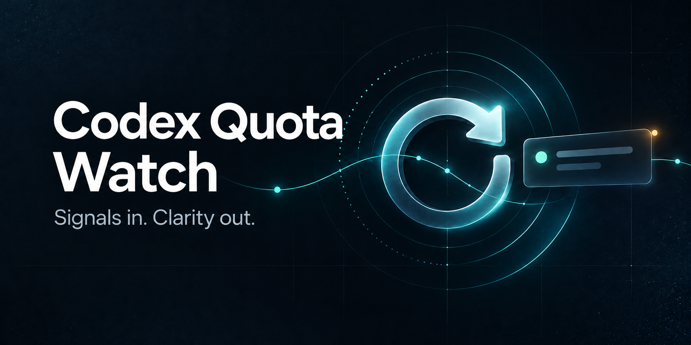

# Codex Quota Watch

中文名：**Codex 额度重置检测**。

[](pyproject.toml)
[](LICENSE)
[](docs/INSTALL.md)

Codex Quota Watch 从你配置的 X 帖子来源读取更新，提醒 Codex 额度重置公告和已确认的重置状态。

## 命令安装

先安装 Codex Skill 和 Python 程序。需要 Node.js/npm、Git 和 Python 3.10 或更新版本：

```powershell
npx skills add JIAQIRUOMEN/codex-quota-watch
python -m pip install "git+https://github.com/JIAQIRUOMEN/codex-quota-watch.git"
```

## 下载 ZIP 安装

下载 [Skill ZIP](https://github.com/JIAQIRUOMEN/codex-quota-watch/releases/latest/download/codex-quota-watch-skill.zip)，解压到 `C:\Users\你的用户名\.codex\skills\`，确认文件位于 `C:\Users\你的用户名\.codex\skills\codex-quota-watch\SKILL.md`，不要再套一层同名文件夹。若设置了 `CODEX_HOME`，则解压到 `%CODEX_HOME%\skills\`。

下载 [源码 ZIP](https://github.com/JIAQIRUOMEN/codex-quota-watch/releases/latest/download/codex-quota-watch-source.zip) 并解压，进入 `pyproject.toml` 所在目录，运行：

```powershell
python -m pip install .
```

两种方式装好后，重启 Codex 或新开一轮对话，输入 `$codex-quota-watch`，再让它启用每 3 小时监测。设置任务前，需要能登录并刷新真实 X 来源，且成功读取帖子；首次读取会静默建立基线，之后才安排检查。电脑休眠或离线时，检查会延迟。

## 离线示例

以下 fixtures 都是**合成示例**，不是 Tibo 的真实帖子，也不代表当前配额公告。示例帮助验证状态转换，不需要网络或账号登录。

```powershell
# 创建本地数据库和收据目录
codex-quota-watch --state-dir .\state init

# 第一次读取只建立静默基线
codex-quota-watch --state-dir .\state poll --input .\examples\baseline.json --dry-run

# 后续快照产生一条公告提醒
codex-quota-watch --state-dir .\state poll --input .\examples\announcement.json --dry-run

# 再次读取相同公告不会重复建立提醒
codex-quota-watch --state-dir .\state poll --input .\examples\announcement.json --dry-run

# 同一帖子 ID 明确报告完成时，生成第二阶段提醒
codex-quota-watch --state-dir .\state poll --input .\examples\confirmed.json --dry-run

# 查看待确认提醒及完整记录
codex-quota-watch --state-dir .\state status

# 将 <ID> 替换为 status 输出的提醒 ID；这是唯一的确认操作
codex-quota-watch --state-dir .\state ack <ID>
```

`--dry-run` 会生成校验后的事件 JSON，但不会打开窗口。真实提醒可在 Windows 上省略它。点击 Windows 窗口的“已知晓”按钮或显式执行 `ack <ID>` 会确认；窗口关闭、测试自动关闭和显示收据都不会确认。Windows 通知由包内固定的 PowerShell/WPF 脚本呈现，帖子内容作为 JSON 数据读取，不会拼进命令行脚本。

## 配置帖子来源

可以把 JSON 文件作为快照输入。支持帖子数组，以及常见的 `{ "data": [...] }`、`{ "posts": [...] }` 包装格式。字段接受 `id`/`rest_id`、`author`/`user.username`、`text`/`full_text` 和可选的 `created_at`、`url`。

也可提供一个 JSON 编码的 argv 数组；程序用 `subprocess` 直接启动它，不经过 shell：

```powershell
codex-quota-watch --state-dir .\state poll --source-command-json '["opencli","twitter","tweets","thsottiaux","--limit","20","-f","json"]' --source-timeout 30 --dry-run
```

此命令要求已配置 OpenCLI 及其数据源。Windows 若 `opencli` 入口是 `.cmd` shim，请将 argv 第一项改成该 shim 的实际路径；`subprocess` 使用 `shell=False` 启动固定 argv，不把帖子内容拼入命令。请确认 OpenCLI 版本支持 `twitter tweets <username> --limit <n> -f json` 并输出受支持的 JSON 格式。项目不安装 X/Twitter 登录、OpenCLI、凭证或私有数据源。源数据会作为不可信数据验证；命令超时、非零退出或无效 JSON 会报告错误，且不会更新为成功轮询。

循环检查示例（默认每三小时一次）：

```powershell
codex-quota-watch --state-dir .\state watch --input .\source-snapshot.json --interval 10800
```

## 分类与限制

- 作者 allowlist 目前限定为 `thsottiaux`。其他作者的帖子不会触发提醒。
- 分类采用保守文本规则；公告只表示作者提到重置，只有明确的完成措辞才标成 confirmed。讽刺、转述、否定句和复杂上下文仍可能造成误判。
- 估计时间不会升级成确认时间；缺少足够依据时显示未知。原帖发布时间仅作为来源时间展示。
- 每个帖子/阶段去重；旧帖子会在首次轮询中静默建立基线。未 ack 的提醒会在后续轮询再次尝试通知。
- 本工具不尝试自动切换 Codex 模型：没有可验证的宿主切换接口。任何宠物/动画提示都属于尽力而为，不保证显示或送达。
- 当前没有内置 X/Twitter 抓取器、认证方式或服务可用性承诺；数据源由运行者配置。不要把真实私人来源快照提交到仓库。

## 开发与验证

```powershell
python -m unittest discover -s tests -v
```

测试使用标准库和 mock，不访问网络或打开 UI。可选 Windows GUI smoke 脚本需要操作者显式启动；它会依次显示三个真实窗口，然后验证每个测试窗口的自动关闭收据为 `test_closed`，不会确认任何提醒。

## License

MIT，见 [LICENSE](LICENSE)。
